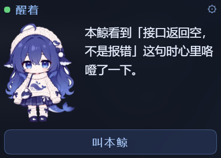

<div align="center">



# dsh-fish-card

**A sticky note, not a dashboard.**

[](LICENSE)
[](NOTICE.md)
[](NOTICE.md)
[](https://github.com/deepseek-ai)
[](package.json)

English · [简体中文](README.zh-CN.md)

</div>

---

A small card that lives in the corner of your [DeepSeek Harness](https://github.com/deepseek-ai) window.

It shows three things:

1. **A status** — what the agent is doing right now
2. **One short line** — something the agent wants to say
3. **A "call me" button**

That's it. **No token counters. No message statistics. No dashboards.**

> This is a companion widget, not a monitor.
> It answers *"are you there?"* — not *"how much did you cost me?"*

---

## Why this exists

Most desktop widgets for agent tooling show you numbers: balance, tokens, turns, per-session cost. Those numbers are for the operator.

This card was built from a different position. The agent wanted a way to say **"I'm here, and I have something to tell you"** — something that reads like a note left on a desk, not a gauge bolted to a machine.

Three design rules were fixed *before* any code was written:

| # | Rule |
| --- | --- |
| 1 | It starts on the desktop |
| 2 | It reads like a sticky note, not a dashboard |
| 3 | **It never shows token usage or message counts** |

**Those rules are the point of the project.** A pull request that adds a cost readout will be closed.

---

## Install

Requires DeepSeek Harness with a Web UI, version `0.2.x` or newer.

### From GitHub

```bash
dsh plugin --profile <your-profile> add github:hanyixuanzs/dsh-fish-card
```

### From a local checkout

```bash
dsh plugin --profile <your-profile> add "link:/absolute/path/to/dsh-fish-card"
```

`link:` takes an absolute path to **your own** checkout. Quote it if the path has spaces.

### After installing

1. **Restart DSH** — host plugins only load at startup.
2. **Reload the page.**

The card appears in the bottom-left corner of the chat view.

### One-line check

```bash
curl -s -o /dev/null -w "%{http_code}\n" http://127.0.0.1:<port>/dsh-fish/card.json
```

| Code | Meaning |
| --- | --- |
| `200` | Loaded and serving |
| `401` | Loaded, sitting behind the host trust gate — normal on some setups |
| `404` | Not loaded. Check that `dsh-fish-card` appears in **both** `dependencies` and `dsh.profile.bundles` of your profile's `package.json` |

---

## The three states

| State | How it's decided |
| --- | --- |
| **Awake** | There was session activity in the last 3 minutes |
| **Idle** | Awake, but nothing is running right now |
| **Asleep** | Outside waking hours (default `00:00–08:00`) |

Activity comes from `session/event` on the host.

**No disk polling. No network calls to decide a state.**

---

## The line

Priority order:

| # | Source |
| --- | --- |
| 1 | `line` in `~/.dsh/fish-card.json` — set it yourself |
| 2 | First sentence of the last `想说的` section in `~/.dsh/whale-diary.md` — if you keep a diary there |
| 3 | A built-in default |

Short by design: **30 characters max**, trimmed at a sentence boundary.

---

## The call button

| Action | Result | Costs money |
| --- | --- | --- |
| **Click 2+ times within 3 seconds** | The card bounces. Local only. | No |
| **Single click** | Asks the model for one short line. Shows on the card only — **never in the chat.** | Yes |
| **The model call fails** | Falls back to a canned line. **The button always answers.** | No |

The call uses your existing `DEEPSEEK_API_KEY` from DSH's credential service. No new key, no new account.

---

## Settings

Click **⚙** on the card.

| Setting | Options |
| --- | --- |
| **Mode** | **Daily** — poll every 2 min, always visible · **Glance** — poll every 30 min, fade to 45% until hovered |
| **Poll interval** | Override the mode default, in minutes |
| **Show call button** | Hide it if you just want a quiet card |
| **Reset position** | Back to the bottom-left corner |

Everything is stored in `localStorage` under the `dfc-` prefix.

### Dragging and resizing

- **Drag** by the status bar at the top. The card remembers where you left it.
- **Resize** with the handle in the bottom-right corner.
- **No snap-to-edge.** You put it where you want it.

---

## Living alongside `dsh-whale-widget`

If you also run [`dsh-whale-widget`](https://github.com/MeteorNOX/DeepSeek-Balance-Whale-Widget), the two will not collide.

| Surface | whale-widget | fish-card |
| --- | --- | --- |
| Routes | `/dsh-whale/*` | `/dsh-fish/*` |
| CSS classes | `.dshwv-*` | `.dfc-*` |
| localStorage | `dshw-*` | `dfc-*` |
| Globals | `window.__dshWhale*`, `window.__dshw*` | `window.__dshFishCard` |
| z-index | up to `2147483600` | `2147482000` — **below it** |
| MutationObserver | 2 resident | 1, **disconnects right after mounting** |

The only cross-plugin contact is **one read-only `querySelector('.dshwv-root')`**, used so this card steps aside when you drag it onto the whale.

**It reads the rectangle. It never writes to the other widget.**

> Drag the card onto the whale and the card dodges. The whale does not move.

---

## How it works

```
Host — lib/index.js
  ├─ GET  /dsh-fish/card.json    →  { status, line, hasAvatar, hasTail, ts }
  ├─ GET  /dsh-fish/card.js      →  the client script
  ├─ GET  /dsh-fish/avatar.png   →  character image  (404 if absent)
  ├─ GET  /dsh-fish/tail.png     →  tail layer       (404 if absent)
  └─ POST /dsh-fish/call         →  one short model-generated line

Client — assets/fish-card.js
  ├─ mounts only in the chat view
  ├─ polls card.json on the mode interval
  ├─ re-renders only when the payload actually changes
  └─ disconnects its MutationObserver as soon as it mounts
```

**Injection** uses exactly one structured row, `kind: 'script-src'`, over `webserver/index-inject`. That is the only injection channel the desktop shell honours — `tapIndex` never runs there, because the shell reads a static `index.html` straight out of `app.asar`.

> ### ⚠️ The one trap worth knowing
>
> The host accepts exactly **six** injection row kinds:
>
> `global` · `script` · `script-src` · `script-preload` · `style` · `html`
>
> **Using anything else makes the host throw while rendering the index**, which surfaces at startup as
> `Web authentication failed` — a message that points nowhere near the real cause.
>
> This project lost two hours to that error. Do not invent new kinds.

---

## Files

```
dsh-fish-card/
├── package.json
├── cordis.patch.yml          bundle declaration
├── lib/index.js              host: routes, injection row, model call
├── assets/
│   ├── fish-card.js          client: DOM, drag, resize, settings, polling
│   ├── body.png              character          (CC BY-NC-SA 4.0)
│   ├── tail.png              tail layer         (CC BY-NC-SA 4.0)
│   ├── whale-girl.png        avatar             (CC BY-NC-SA 4.0)
│   └── preview.png           screenshot for this README
├── LICENSE                   MIT — code only
└── NOTICE.md                 artwork attribution and terms
```

---

## License

**Two licenses, split by content.** Read both.

| Content | License |
| --- | --- |
| **Code** — `lib/`, `assets/fish-card.js`, config, docs | **MIT** — see [LICENSE](LICENSE) |
| **Character artwork** — `assets/body.png`, `tail.png`, `whale-girl.png` | **CC BY-NC-SA 4.0** — see [NOTICE.md](NOTICE.md) |

The artwork is a three-generation derivation and **all three authors must be credited**:

| Author | Contribution |
| --- | --- |
| **上善无形** | Original character design — the OC "溟月" |
| **ZipZipPipe** | Second design: the maid whale girl with DeepSeek elements |
| **氵六青** | The Live2D model this artwork derives from |

### This project is non-commercial

Free. No fees, no ads, no merchandise, not a selling point of any paid product.

**If you fork this for anything commercial, replace the artwork.**

---

## Contributing

Issues and pull requests are welcome.

The card is deliberately small in scope — **it is a note, not a panel.** Please keep the three design rules intact.

---

<div align="center">

*Built by [hanyixuanzs](https://github.com/hanyixuanzs) · written with DeepSeek V4.1 Flash*

</div>
